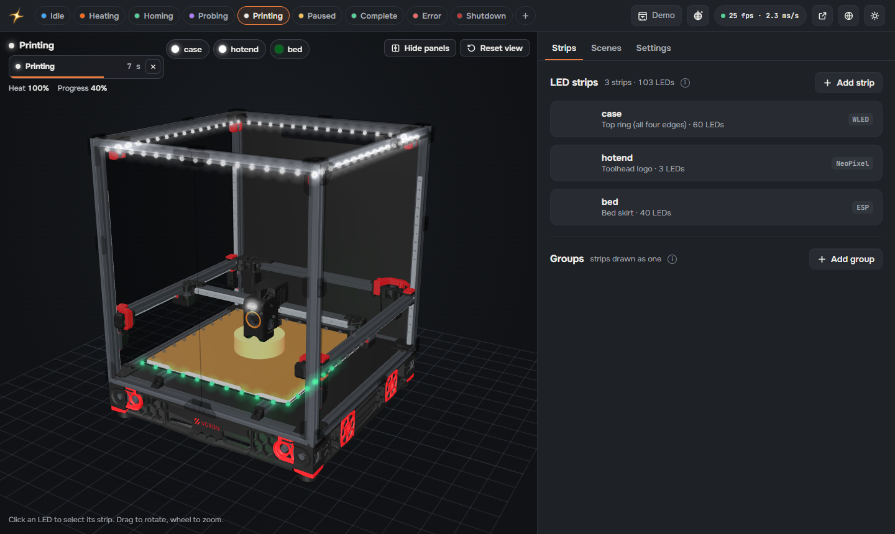
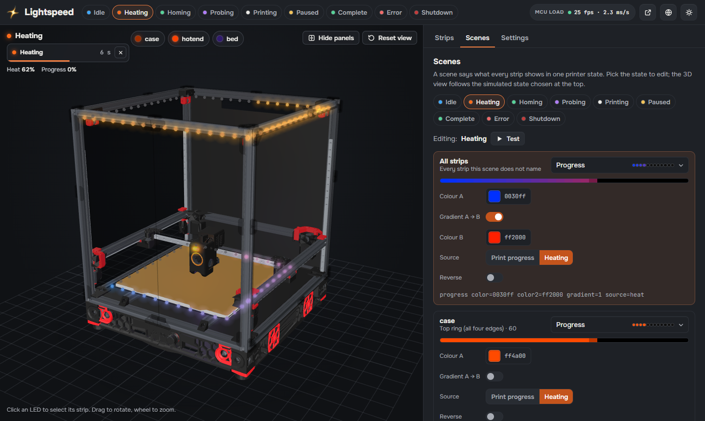
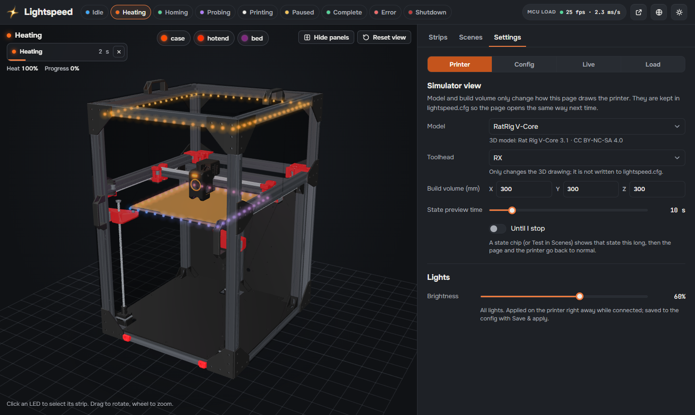
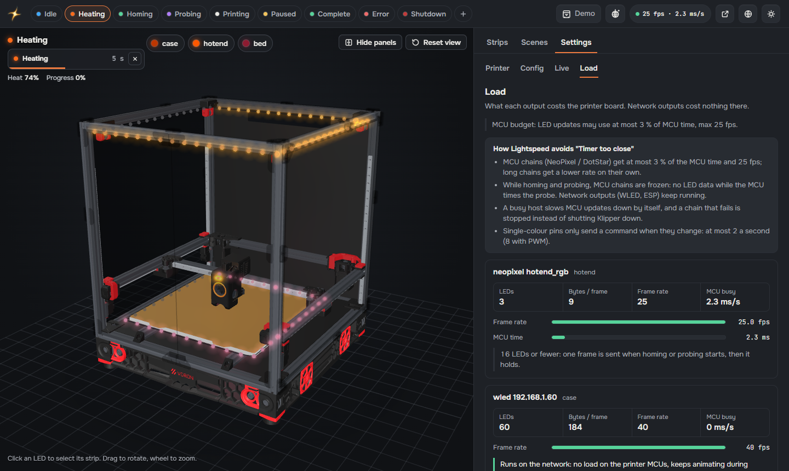

<p align="center"></p>

<h1 align="center">Lightspeed</h1>
<p align="center"><b>Fast, MCU-safe LED effects for Klipper with a web controller and live 3D printer preview.</b></p>
<p align="center">Design your printer's LEDs on a page instead of in config files. Drives NeoPixel, WLED and ESP32 strips without "Timer too close" errors.</p>

<h3 align="center"><a href="https://oznlab.com/lightspeed/">▶ Open the live demo</a></h3>
<p align="center">No install. Pick a printer, place your strips and watch every printer state light up in 3D.<br><a href="#install">Install Lightspeed</a> · <a href="https://github.com/ozancs/lightspeed/issues">Share feedback</a></p>

<p align="center">
  <a href="https://oznlab.com"></a>
  <a href="https://discord.gg/KZWva6dq38"></a>
  <a href="https://www.youtube.com/@oznlab"></a>
</p>

> **v0.1: early release.** It runs on my own printer every day, but it has not seen many other setups yet. Please open an issue if something does not work on yours.

## Why another LED plugin

**LED setups should not be written by hand.** With most LED plugins you type chains, LED ranges and effect layers into config files, restart Klipper and look at the printer to see what you got. Lightspeed gives you a page instead:

- **See it before it lights up.** Your printer is drawn in 3D with your strips on it. Pick a state (heating, printing, error…) and watch every strip react, on the page and on the real LEDs at the same time.
- **Click instead of typing.** Add a strip, choose its chain and LED range, place it on the printer and pick an effect from a list with live previews. Colours, speed and brightness are sliders and swatches.
- **Everything in one place.** All strips, all states and what each one shows are on one screen, so changing a setup later is a minute's work, not a search through config files.
- **Saved safely.** The page writes `lightspeed.cfg` for you, keeps a backup and restarts Klipper only when nothing is printing.

**And the LEDs never stop a print.** With the popular `led_effect` plugin, long strips on the printer's MCU, or effects running while the printer homes or probes, can end a print with **"Timer too close"** or **"Missed scheduling"**. Lightspeed always lets motion go first:

- **A budget for the MCU.** LED data on a Klipper MCU chain (NeoPixel / DotStar) may use at most 3 % of MCU time and 25 fps. Long chains get a lower frame rate by themselves.
- **Quiet while homing and probing.** MCU chains are frozen while the MCU times a probe; network strips keep going.
- **Backs off when the host is busy**, and a chain that fails is stopped instead of shutting Klipper down.
- **Strips that cost the MCU nothing.** Run long strips on an ESP32 with WLED, or on an ESP bridge node, and keep only a few LEDs (toolhead logo, nozzle) on the MCU.
- **Single-colour lights too.** A plain case light on an `output_pin` takes part in the scenes, with at most 2 commands a second.

## What it does

- **Scenes per printer state:** idle, heating, homing, probing, printing, paused, complete, error and shutdown, picked from Klipper's real state. Each strip can have its own effect in each scene.
- **Effects:** solid, breathe, blink, rainbow, chase, comet, scan, twinkle, fire, progress (print progress or heating, with an A → B colour gradient), heat and follow (a light that follows the nozzle).
- **Blinks stay in step:** every blink in a state shares one period and one clock, on every output.
- **Web controller:** a page served by your printer (next to Mainsail or Fluidd) that shows your printer in 3D with your strips on it. Click a state to preview it on the page and on the printer, change effects and colours live, and save straight to `lightspeed.cfg`. Save & apply backs up the old file and restarts Klipper only when nothing is printing.
- **Real printer models:** Voron 2.4, Voron Trident, Voron 0.2, Rat Rig V-Core 3.1, an enclosed CoreXY (VzBot Vz-330) and a bed slinger (Ender-3), built from their official CAD, with Stealthburner, RX, DownDraft or Dragon Burner toolheads. The model is stretched to your build volume.
- **14 languages** on the page.

## Take a look

These are screenshots of the page. Click one to open the live demo.

### Your printer, your strips

[](https://oznlab.com/lightspeed/)

### Every state, every strip

[](https://oznlab.com/lightspeed/)

### Many printers

[](https://oznlab.com/lightspeed/)

### Load on the MCU

[](https://oznlab.com/lightspeed/)

## Install

On the printer (Raspberry Pi or similar, with Klipper, Moonraker and Mainsail or Fluidd):

```bash
cd ~
git clone https://github.com/ozancs/lightspeed.git
cd lightspeed
./install.sh
```

The installer links the module into Klipper, links the page into Mainsail/Fluidd and creates `~/printer_data/config/lightspeed.cfg` from the example when you have none. It does not edit `printer.cfg` and restarts nothing.

Then:

1. Add `[include lightspeed.cfg]` to `printer.cfg`.
2. If you used `led_effect` before, remove its `[led_effect ...]` sections and its include. Two plugins must not drive the same strip. Automatic migration from `led_effect` is planned for the next version.
3. Restart Klipper when the printer is idle.
4. Open `http://<your-printer>/lightspeed/lightspeed.html`, design your strips and press **Save & apply**.

A Mainsail or Fluidd update removes the page link; run `./install.sh` again after one.

### Updates from Mainsail / Fluidd

Add this to `moonraker.conf`:

```ini
[update_manager lightspeed]
type: git_repo
path: ~/lightspeed
origin: https://github.com/ozancs/lightspeed.git
primary_branch: main
managed_services: klipper
```

## Configuration

The page writes `lightspeed.cfg` for you. By hand it looks like this (colours are `rrggbb` without `#`, because `#` starts a comment):

```ini
[lightspeed]
brightness: 0.6

[lightspeed strip hotend]
output: neopixel hotend_rgb      # an existing [neopixel] section
leds: 1-3
place: toolhead_logo

[lightspeed strip case]
output: wled 192.168.1.60        # an ESP32 running WLED: no MCU load
count: 60
place: top_ring

[lightspeed scene printing]
hotend: solid color=ffffff
case: progress color=ffffff color2=101010
```

Outputs: `neopixel <name>`, `dotstar <name>`, `pin <output_pin name>`, `wled <ip>[:port]` and `esp_bridge <prefix>`. See [docs/CONTRACT.md](docs/CONTRACT.md) for every option.

## Console commands

| Command | What it does |
|---|---|
| `LIGHTSPEED_STATUS` | What each strip shows and why, with its frame rate |
| `LIGHTSPEED_STATE STATE=<state\|auto> [HOLD=s]` | Show a state for a while (a test), or go back to automatic |
| `LIGHTSPEED_PREVIEW STRIP=<name\|all> EFFECT="comet color=ff6b1a" [HOLD=s]` | Try an effect on one strip |
| `LIGHTSPEED_SCENE STATE=<state> STRIP=<name\|all> EFFECT="..."` | Change a scene until the next restart |
| `LIGHTSPEED_BRIGHTNESS VALUE=0.4` | Brightness of all lights |
| `LIGHTSPEED_STRIP STRIP=<name> BRIGHTNESS=0.5` | Brightness of one strip |
| `LIGHTSPEED_ENABLE VALUE=0\|1` | Stop or start all LED output |

The page talks to the module through its own Moonraker endpoint, so previews from the page do not fill the console.

## 3D models and their licences

The printer and toolhead models are built from the makers' published CAD with the scripts in `tools/models/`:

| Model | Source | Licence |
|---|---|---|
| Voron 2.4, Trident, 0.2, Stealthburner, DownDraft | Voron Design | GPL-3.0 |
| Dragon Burner | chirpy2605/voron | GPL-3.0 |
| Ender-3 | Creality | GPL-3.0 |
| Rat Rig V-Core 3.1 | Rat Rig | CC BY-NC-SA 4.0 (non-commercial) |
| VzBot Vz-330 | VzBoT3D | CC BY-NC 4.0 (non-commercial) |
| RX toolhead (v5) | [Raidy on Printables](https://www.printables.com/model/1779906-rx-toolhead-v5-using-bambu-h2sa1-gear-h2d-hotend) | see the Printables page |

The Rat Rig and VzBot models are for non-commercial use only. The page uses [three.js](https://threejs.org) (MIT).

## License

Lightspeed is released under the GNU General Public License v3.0. See [LICENSE](LICENSE).

## Support

Questions, bugs and ideas: [open an issue](https://github.com/ozancs/lightspeed/issues) or join the [Discord](https://discord.gg/KZWva6dq38).
